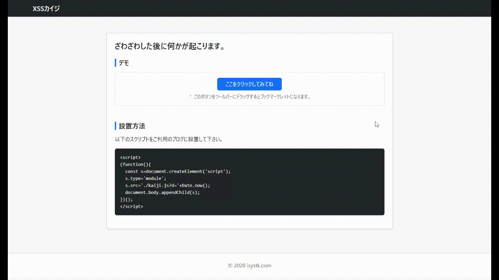

# xss-kaiji


## 📗 プロジェクトの概要

XSS（クロスサイトスクリプティング）をテーマにしたWebアプリケーション「XSSカイジ」です。セキュリティ学習やデモンストレーションを目的としています。

### 対象としている方

- Webアプリケーションのセキュリティ（XSS）に関心のある開発者
- TypeScriptおよびViteを用いたフロントエンド開発を学びたい方

### 利用している技術

#### インフラ / 実行環境
- **Node.js**
- **Vite**

#### 使用しているライブラリ
- **Frontend**: TypeScript, Bootstrap, @popperjs/core
- **Design/Tool**: FontAwesome, ESLint, Prettier

## 🎥 デモ動画


## 📦 ディレクトリ構造

```text
.
├── LICENSE
├── README.md
├── dist
│   ├── assets
│   ├── images
│   ├── index.html
│   ├── index.js
│   └── kaiji.js
├── eslint.config.js
├── package-lock.json
├── package.json
├── public
│   ├── images
│   └── index.html
├── src
│   ├── index.html
│   ├── index.ts
│   └── ts
├── tsconfig.json
└── vite.config.js
```

## 🔧 開発環境の構築

### 前提条件

* Node.js (v18.0.0 以上推奨)
* npm または yarn

### セットアップ手順

1. **リポジトリのクローン**
```bash
git clone git@isystk-github.com:isystk/kaiji.git
cd xss-kaiji
```

2. **環境構築**
```bash
npm install
```

3. **初期設定・動作確認**
```bash
# 開発用サーバーの起動
npm run dev

# プロダクション用ビルド
npm run build
```

## 🎧 外部ツール・サーバー

| ツール | URL | 用途 |
| --- | --- | --- |
| Vite | https://vitejs.dev/ | フロントエンドのビルドおよび開発サーバー |
| FontAwesome | https://fontawesome.com/ | アイコンフォントの利用 |

## 🎫 Licence

[MIT](./LICENSE)

## 👀 Author

[isystk](https://github.com/isystk)
